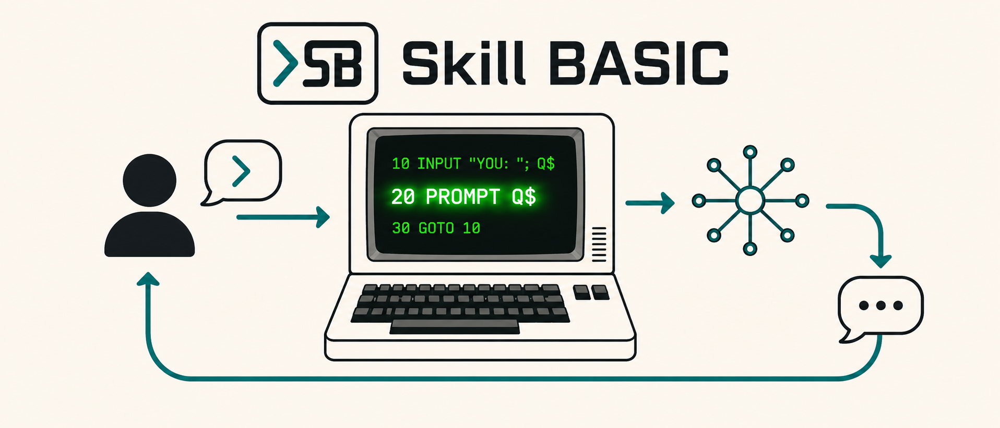

# Skill BASIC



Skill BASIC is an experimental, prompt-native programming language built around
one central operation: `PROMPT`.

Prompt-only workflows are expressive, but they become difficult to manage when
a task needs explicit state, branching, repetition, reusable subroutines, user
input, or a predictable execution order. Skill BASIC combines AI prompts with
the familiar control structures of BASIC so that prompts can participate in a
larger, inspectable program instead of remaining an unstructured sequence of
instructions.

The following chatbot is a compact example of that idea:

```basic
5 REM AI CHATBOT
10 INPUT "YOU: "; Q$
20 PROMPT Q$
30 GOTO 10
```

Apart from its comment, the chatbot needs only three lines: read a message,
send it to the AI backend, and repeat. Skill BASIC supplies the interaction
loop, while `PROMPT` supplies the generated response. Because recent
conversation history is retained, the same three-line loop supports follow-up
questions rather than treating every turn as an isolated request.

## Vision

The long-term goal is to provide a logical programming layer for AI skills.
`PROMPT` supplies generative intelligence; BASIC supplies variables, conditions,
loops, subroutines, data, and deterministic control flow. Together, they make it
possible to describe AI behavior as readable programs that can be executed,
tested, revised, and shared.

Skill BASIC is intended to evolve beyond the limits of building increasingly
complex workflows from prompts alone. It explores a model in which natural
language handles open-ended reasoning while a small programming language
handles orchestration and logic.

The interpreter is written in Rust. Version 0.1 supports pi RPC as the default
AI backend and [Ollama](https://ollama.com) as a local-model backend. Skill
BASIC is not intended to be tied to one model, provider, or API. Future versions
may connect `PROMPT` to additional local and hosted AI services. The project is
under active development, and language behavior or command syntax may change
before version 1.0.

## Features

- A first-class `PROMPT` statement with bounded conversational context
- A compact logical layer for structuring multi-step AI behavior
- Interactive and file-based execution
- pi RPC by default, with Ollama available via `--engine ollama`
- A provider-independent direction for future `PROMPT` backends

## Requirements

- Rust 1.90 or later
- The `pi` CLI for the default backend, or Ollama when using `--engine ollama`

## Quick start

Clone the repository, then build and run it:

```console
cargo build
cargo run
```

Run the test suite:

```console
cargo test --locked
```

See the concise [manual](MANUAL.md) for commands, syntax, configuration, and
examples.

## AI backends

`PROMPT <expression>` (or its `! <expression>` shorthand) evaluates its argument as a string, sends it to the
configured AI backend, and prints the response. This makes a model interaction
usable anywhere a BASIC statement can appear. The chatbot at the beginning of
this README combines it with `INPUT` and `GOTO` to create a continuous
conversation in three executable lines.

Responses are printed and flushed as streamed chunks arrive.

Recent user and assistant messages are retained for follow-up prompts. History
is reset at the start of each `RUN` and is bounded to limit memory use.

Interactive REPL and BASIC `INPUT` lines use Unicode-aware editing, including
multibyte-safe Backspace/Delete, cursor movement, and in-memory history. Piped
input is read lossily so a malformed UTF-8 byte does not terminate a program.

### Ollama

Select Ollama with `--engine ollama`:

```console
cargo run -- --engine ollama samples/aichatbot.bas
```

Ollama makes it easy to run with local models and also supports remote or cloud
model configurations. This is an implementation option, not a restriction on
the language's future direction.

Local Ollama models can process prompts without sending them to a model
provider. Cloud models and remote Ollama hosts send prompt and recent
conversation data to another system. Do not include credentials, private data,
or other secrets in prompts.

### pi RPC

By default, Skill BASIC uses an installed `pi` CLI through pi RPC. You can also
select it explicitly with `--engine pi-rpc`:

```console
cargo run -- --engine pi-rpc samples/aichatbot.bas
```

Skill BASIC starts `pi --mode rpc --no-session`. Tools and extensions are
disabled by default, so a prompt cannot run shell commands or modify files.
Optional pi settings can be added alongside the existing Ollama settings in
`.env/settings.json`:

```json
{
  "host": "http://localhost:11434",
  "model": "llama3.2",
  "pi": {
    "model": "provider/model",
    "system": "You are a concise assistant.",
    "tools": false,
    "timeoutSeconds": 300
  }
}
```

If `pi.model` or `pi.system` is omitted, pi uses its own configured default.
Setting `pi.tools` to `true` enables pi's normal tools and extensions with the
invoking user's permissions. RPC operations time out after 120 seconds by
default; set `pi.timeoutSeconds` for slower models or first-run initialization.
`RUN`, `NEW`, and `CLEAR` reset the pi conversation before the next `PROMPT`.
If a pi RPC process fails or times out, the next `PROMPT` starts a fresh pi RPC
process. Generated text is printed and flushed as streamed chunks arrive. When
pi reports a thinking phase before answer text, Skill BASIC prints
`[pi thinking...]` once and does not expose the hidden thinking text.

### Future providers

The project welcomes discussion and contributions for a clean backend boundary
and integrations with other AI services. Useful contributions include provider
interfaces, authentication and configuration design, streaming responses,
portable conversation formats, mock backends for testing, and implementations
for additional local or hosted model APIs.

New backends should preserve the simple language-level behavior of `PROMPT`,
avoid embedding provider-specific concepts in BASIC programs where possible,
and document their privacy, authentication, and data-retention implications.

## Security

Skill BASIC is a local interpreter, not a sandbox. `LOAD` and `SAVE` can access
files allowed by the invoking user's permissions. Run only trusted programs,
avoid elevated privileges, and use a trusted AI backend.

See [SECURITY.md](SECURITY.md) for vulnerability reporting instructions.

## Contributing

Bug reports and focused pull requests are welcome. See
[CONTRIBUTING.md](CONTRIBUTING.md) and [CODE_OF_CONDUCT.md](CODE_OF_CONDUCT.md)
before participating.

## Project structure

- `src/lexer.rs`, `src/token.rs`: lexical analysis
- `src/parser.rs`, `src/ast.rs`: recursive-descent parser and syntax tree
- `src/interp.rs`: tree-walking interpreter
- `src/builtins.rs`, `src/value.rs`: values and built-in functions
- `src/ai.rs`: v0.1 Ollama `/api/chat` backend
- `src/main.rs`: CLI and REPL
- `samples/`: runnable BASIC programs

## License

Licensed under the [Apache License 2.0](LICENSE).
